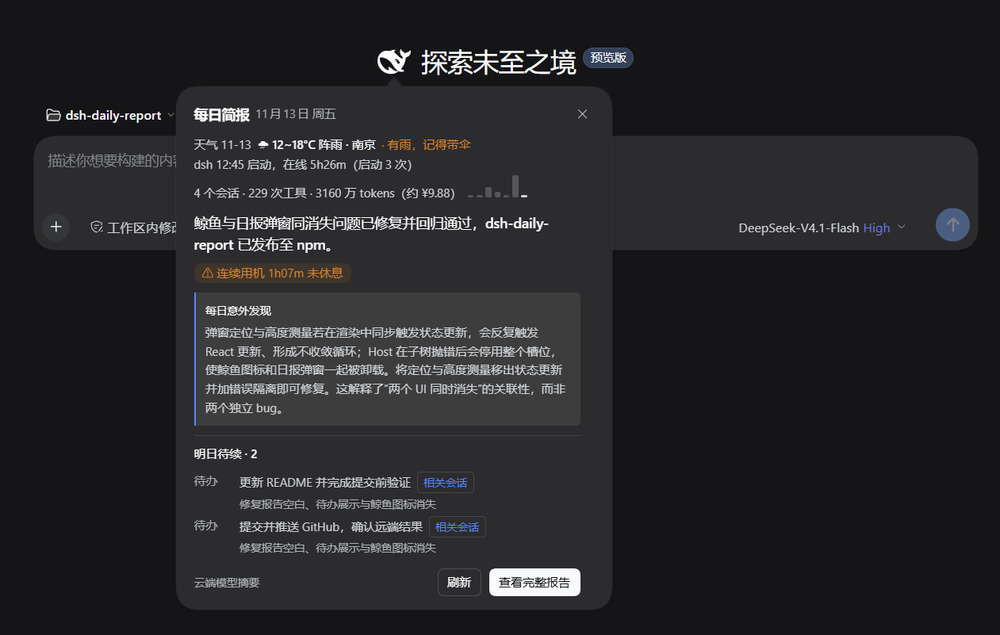
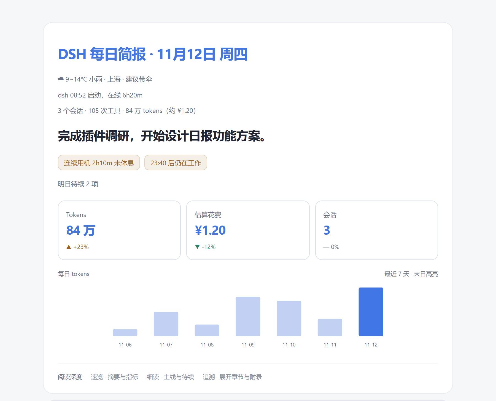
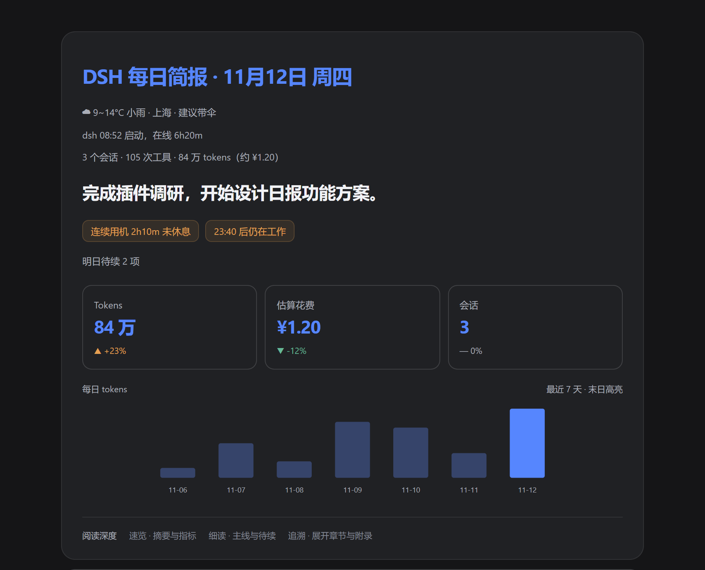
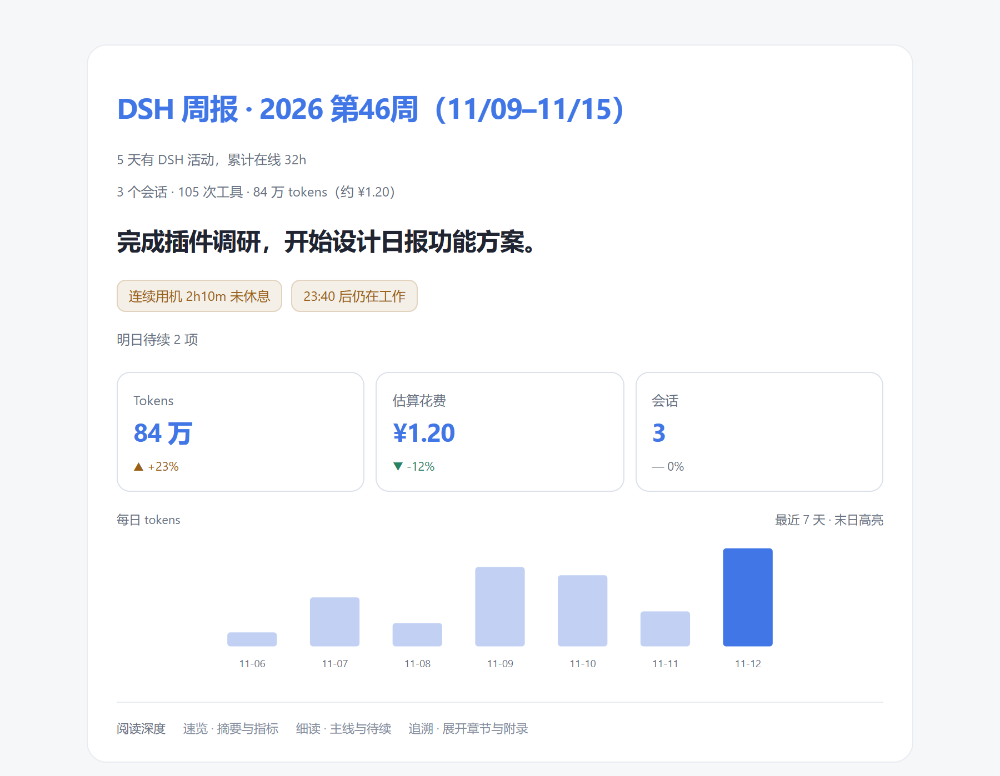

# dsh-daily-report · DSH 每日简报

把本机的 DSH 会话整理成一份能快速读完的简报：今天做了哪些事、用了多少 token、花了多少钱、哪里卡住、明天接着做什么，外加天气、dsh 启停时间和作息提醒。

[](https://github.com/Yutai233/dsh-daily-report/actions/workflows/ci.yml)


> **先读这段**：插件默认走 **A 档 · 云端模型摘要**——只把压缩后的事实包（会话标题、改动文件、命令、待办这类事实）发给 DSH 默认模型，原始会话正文不上传；想完全不调用模型，在 设置 → 每日简报 → 隐私 里切到 B 档即可。报告本身仍会包含会话标题、路径、命令和域名，分享前请自己检查。

## 特性

| 能力 | 说明 |
|---|---|
| 日报与摘要 | 三层日报（30 秒速览 / 约 3 分钟细读 / 附录）；会话先压成事实包再写摘要，按会话与事件序号缓存；Markdown 全量落盘，可选注册 `daily_report` 工具 |
| 卡片与待续 | 欢迎页鲸鱼上方早晨卡片：天气、用量与生成消耗一屏读完，另有按需生成的「每日发现」；待续置顶、按会话活跃度排序，可一键回到来源会话 |
| 统计与成本 | 工具调用排行与失败/耗时、改动文件与域名；token、花费、缓存命中、预算提醒；近 7 天 ▲▼ 对比与迷你柱状图。默认价目对齐 DeepSeek 官方 Flash 价（命中 0.04 / 未命中 2 / 输出 8 元每百万 tokens），工作日峰时按标价，其余时段与周末、法定节假日五折，Pro 模型 ×3 |
| 健康与周期 | 键鼠空闲采样（Windows，默认开）与实时久坐通知：连续用机超阈值当场弹 Windows Toast，不必等第二天；日报之外还有按 ISO 周与自然月聚合的周报、月报 |
| 插件联动 | 可选读取 dsh-context / billion-context 的运行数据：日报多一格 bili 压缩收益，卡片用量面翻出「bili-c 净省 [约] X tokens」，每日发现可带「插件联动」标签。两个独立开关默认开，详见 [插件联动](#插件联动) |

两条规则贯穿报告：**数字由代码计算，模型只负责写文字**；**没有变化的段落不渲染**。

## 界面预览

欢迎页鲸鱼 logo 上方弹出的早晨卡片（真实桌面截图，含「每日发现」与「明日待续 → 相关会话」入口）：



日报与周报（由 `test/fixtures/sample-report.mjs` 的合成数据渲染）：



<details>
<summary>深色日报 / 周报</summary>





</details>

> 卡片图是真实桌面截图；其余三张由合成数据渲染（`node test/gen-docs-images.mjs` 可重新生成），不含任何真实会话内容，展示的是导出的报告页面本身，DSH 内的查看器还会套一层原生弹窗外壳。

## 安装

前置条件：DSH Desktop `>= 0.2.2-rc.1`。插件依赖 Host 的 `sessionQuery`、`connection`、`tools`、`systemPrompt` 服务。运行时零第三方依赖，只用 `node:*` 内置模块与全局 `fetch`。

已发布到 npm：[`dsh-daily-report`](https://www.npmjs.com/package/dsh-daily-report)，推荐按包名安装。

### 方式一：插件管理（推荐）

1. 打开 DSH 左侧 **插件** 页 → **添加插件**
2. 包名填 `dsh-daily-report`
3. 安装后点 **立即启用**；未开启 HMR 时重启 DSH
4. 打开 **设置 → 每日简报**，页面出现且 `%USERPROFILE%\.dsh\dsh-daily-report\` 开始产生数据即表示挂载成功

### 方式二：命令行

```powershell
& "$env:LOCALAPPDATA\Programs\DeepSeek Harness\resources\runtime\cli\bin\dsh.cmd" `
  plugin --profile desktop add dsh-daily-report
```

### 方式三：本地目录（离线或要改代码）

1. 克隆或下载本仓库，记下仓库根的绝对路径，例如 `E:\path\to\dsh-daily-report`
2. **添加插件** 时包名填该绝对路径，或 `add "link:E:/path/to/dsh-daily-report"`

移除时把 `add ...` 换成 `remove dsh-daily-report`。不要手动复制进 `node_modules`。

> 仓库根就是插件包根（`package.json` 在根目录），所以路径指向 clone 下来的仓库目录即可，不需要再进子目录。

## 使用

- **卡片与提示**：点新会话页鲸鱼可开合简报；有未查看简报时显示小点，并播放与悬停相同的摆尾动效。打开卡片后暂停自动提示，悬停动效保留；系统开启「减少动态效果」时仅保留小点。
- **明日待续**：小卡片和完整报告展示相同的待续内容与来源。待续先按来源会话的当日活跃度（token 总数）排序，最忙的会话排在最前；小卡片默认显示前两条，在待续列表内滚动查看其余条目；窗口较矮时，整个内容区也可滚动。
- **继续工作**：待续条目带有来源时，点「相关会话」回到 DSH 原会话。旧归档若未保存会话 ID，不显示无效按钮；系统浏览器中的离线报告也不提供此跳转。
- **完整报告**：「查看完整报告」在 DSH 内打开查看器，也可打开 Markdown 或用系统浏览器查看
- **生成**：设置 → 每日简报 分「隐私 / 健康 / 报告 / 成本」四个页签，可生成日报、本周周报、本月月报并查看历史；默认每天 `09:00` 与首次打开各检查一次。页签栏右侧有「点个 Star ⭐」「遇到问题？提issue↗」和当前版本号三个外链，都在新标签页打开
- **问 agent**：「昨天做了什么」「上周三我修了什么」，或直接读 `%USERPROFILE%\.dsh\dsh-daily-report\reports\**\*.md`
- **久坐通知**：在「健康」页签打开实时提醒后，连续用机超过阈值会当场弹 Windows Toast，通知中心里以「DSH 每日简报」单独出现，可只关掉它而不关整个报告

## 隐私

| 档位 | 配置值 | 内容是否离开本机 | 行为 |
|---|---|---|---|
| **A · 云端模型摘要**（默认） | `cloud` | 是（仅压缩后的事实包） | 把压缩后的事实包发给 DSH 默认模型或指定模型 |
| B · 仅标题 + 统计 | `local-only` | 否 | 不调用模型，会话摘要由标题、改动文件、失败、待办等事实拼成模板句 |
| C · 本地模型摘要 | `local-model` | 否（默认强制回环） | 发给本机 OpenAI 兼容服务（Ollama / LM Studio / llama.cpp） |

档位只由用户在设置页选择，插件不会自动切换，也不会在本地模型失败时改用云端。C 档默认只允许回环地址，需要局域网地址时必须显式打开 `allowLan`。分享报告前请自行检查：报告含会话标题、路径、命令与域名。

插件联动（dsh-context / billion-context）默认开启，但它是独立的同意开关，不是隐私档位的一部分：两个开关在 **设置 → 每日简报 → 报告 → 插件联动**，可随时分别关掉。读了什么、出现在哪里，见下一节。

## 插件联动

可选的跨插件数据接入，默认开启。**装包不等于同意**：只有你把开关打开、且对应插件正在运行，日报才会去读它的运行时数据。

### 什么时候生效

- 数据源是 dsh-context 与本机 bili 的运行态；**包安装了但没运行不算可用**，两边都确认在跑才启用。
- 两个独立开关是 `links.context` 与 `links.bili`（默认都是 `true`）。关掉任一后，日报完全不去读对应插件，卡片不显示 bili 面，发现也不再带「插件联动」标签。
- 关掉它不改变隐私档位、不改变摘要模式，也不会引入额外的云端调用。卸载或停用插件后，归档里遗留的联动字段同样不再展示。

### 读了什么

只从 bili 的 SQLite 里**只读**取两类东西：会话映射与 `cacheLedger` 的数值字段，按报告会话 ID 和本地日期过滤。会话正文、摘要、handoff、工具参数，以及其他插件的详情接口一概不读。读取带超时、行数与内存上限，读不到就静默降级，不影响报告本身。

### 出现在哪里

| 位置 | 内容 |
|---|---|
| 日报 · 今日 tokens | bili 压缩收益：压缩次数、窗口回收量、缓存命中率、异常状态（HTML 里默认收起，有数据时 summary 提示「bili 收益」） |
| 早晨卡片 · 用量面 | 四面棱柱：优先翻出「bili-c 净省 [约] X tokens」（本机 bili 账本全部会话累计，同 bili-c 面板「净节省」口径），没有累计数才用当日净节省；每 3 秒翻一个面、一直向上转，点一下也能提前翻；弹窗打开或页面隐藏时复位 |
| 每日发现 | 卡片里只放正文前 60 字，超出时后面跟一个圆角「详细内容→」按钮，点开完整报告并直接滚到每日发现那一段；模型确实用联动证据解释了异常时，正文末尾追加淡蓝圆角标签「插件联动」（Markdown 为括注），标签不计入正文长度上限 |
| HTML / Markdown | 与卡片同口径；缺数据写「待确认」，不写「无异常」 |

### 数字怎么算

- `reclaimedTokens` 是**当日压缩事件窗口的回收量，不是净节省**。
- 净节省只接受能完整归到当天、可核对的 bili fold 账本，界面标「约」；不拿窗口回收量冒充，也不把 bili 统计加进原用量与费用总计，避免重复记账。卡片 bili 面优先显示**累计净省**：本机 bili 账本里全部会话的 `Σ[(S-σ)·requestsAfter−T−σ]`，与 bili-c 面板「净节省」同一口径，两边看到的是同一个数（累计值直接用面板的 K/M/B 写法，如 `356.0M tokens`）；它不受「能否归到这一天」限制，当天没有映射也会显示，累计不可用时才回落到当日净省。注意这个累计是 bili 自己标注的**理论上界**：每次折叠的节省会乘以其后每个请求数，同一批请求会被多个折叠重复计入，所以它可能大于 bili 记录的输入总量，别当账单读。另外它读的是磁盘账本快照，正在运行的会话还没落盘时会比面板少一点（几百 K 到几 M），会话落盘后追平。
- 部分覆盖不整日作废：bili 没记过账的会话只让数值变成当日下界，卡片标注「9/11 会话可核算」，其余会话照常给出四项指标。
- 会话内部的账本问题（历史不完整、账本冲突、缓存用量未测量）只把对应项置空，不会编一个 0 出来。

## 数据目录

```text
%USERPROFILE%\.dsh\dsh-daily-report\
├─ config.json / state.json
├─ heartbeat/  idle/  facts/  cache/
└─ reports/daily|weekly|monthly/
```

可用环境变量 `DSH_DAILY_REPORT_DIR` 覆盖数据根目录；在 **设置 → 每日简报 → 报告 → 报告保存目录** 输入绝对路径并点「保存目录」，或「恢复默认目录」。目录变更只切换报告读写位置，不搬移或删除旧报告，采样、事实和配置仍在原处。默认保留 180 天，`cache/` 与周报月报不会自动清理。DSH 原始会话日志仍在 `~/.dsh/sessions/`，插件只读不复制。

## 文档

| 文档 | 内容 |
|---|---|
| [docs/GUIDE.md](./docs/GUIDE.md) | 完整使用说明、每个设置项、隐私细节、构建与冒烟脚本、已知边界 |
| [CONTRACT.md](./CONTRACT.md) | 数据契约：`DayFacts`、模块签名、`Report` 结构、渲染规则 |
| [docs/dev/](./docs/dev/) | 开发过程记录：功能设计方案、前期插件调研、阶段性交接说明（历史存档，部分内容可能已过时） |

## 开发

```powershell
node client/build.mjs                                  # 构建前端（改完 client/ 必跑）
node --test --test-timeout=300000 "test/*.test.mjs"     # 跑测试
```

改 `lib/**` 后重启 DSH；改前端后先重新构建 `client.js`，再把插件关掉重开（HMR 只在 `pnpm run dev:web` 时自动刷新）。`client/client.js` 是构建产物且随仓库提交，CI 会校验它与 `client-source.js` + `ui.css` + `fish-paths.js` 逐字节一致。

测试与冒烟脚本的细节见 [docs/GUIDE.md](./docs/GUIDE.md)，数据契约见 [CONTRACT.md](./CONTRACT.md)。

## 目录结构

```text
.
├─ lib/        Host 入口、配置、采集、摘要、分析、渲染
├─ client/     鲸鱼卡片、设置页、报告查看器（client.js 为构建产物）
├─ test/       测试、样例、真机冒烟脚本
├─ docs/       完整使用文档、截图、开发过程记录
└─ .github/    CI
```

## 已知边界

- 仅在 **Windows + DSH Desktop** 上验证；macOS/Linux 与其它 DSH 版本的兼容矩阵尚未验证
- 成本是**估算**，默认价目取 DeepSeek 官方 Flash 价（命中 0.04 / 未命中 2 / 输出 8 元每百万 tokens，峰时；谷时五折；Pro ×3），可在设置里改，不是账单
- 健康提醒在未开键鼠采样时只用 DSH 消息时间粗估，文案会注明；不要把粗估说成实测。实时久坐提醒会同时看消息时间与键鼠采样（采样开时），取更早的起点
- Windows Toast 用自己的 AUMID（`Dsh.DailyReport`，首次发通知时注册到 HKCU，可在「通知和操作」里单独管理），本机实测能投递；被通知设置或专注助手拦住时仍可能看不见
- 真实桌面逐按钮验收仍有缺口，详见 [docs/GUIDE.md](./docs/GUIDE.md) 的「已知边界」
- **插件联动数字是估算**：只在 dsh-context 运行且本机 bili 活跃时生效；窗口回收量不等于净节省，部分会话缺少账本时当日净节省只代表当日下界（卡片会标「9/11 会话可核算」），净节省一律写「约」，不能当账单。累计净省与 bili-c 面板「净节省」同口径，但同为 bili 自己的估算，取整到 0.1 万/亿，不是账单

## License

MIT © 2026 Yutai233 · 见 [LICENSE](./LICENSE)
